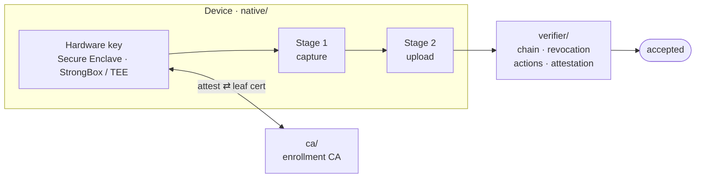

# RealReel C2PA

[](https://github.com/wholeearthlabs/realreel-c2pa/actions/workflows/ci.yml)
[](https://www.npmjs.com/package/@realreel/c2pa-trust-core)
[](https://www.npmjs.com/package/@realreel/photo-attest)
[](https://github.com/wholeearthlabs/realreel-c2pa/pkgs/container/realreel-verifier)
[](./LICENSE)

**Open-source C2PA signing and verification behind [RealReel](https://realreel.xyz)'s authenticity guarantee.**

RealReel is a photo-sharing app that accepts only **genuine, unedited photos
captured in the app**. That guarantee rests on a hardware-bound
[C2PA](https://c2pa.org/) signing and verification pipeline. The app is
closed-source; this repo — how a capture is signed on-device and verified
server-side — is the part anyone can read, audit, and reuse.

> [!WARNING]
> **Not yet independently audited.** Published for transparency and community
> review; it has had no formal third-party security audit. Use at your own risk,
> and report anything you find privately — see [`SECURITY.md`](./SECURITY.md).

## How it works



Every RealReel photo carries a **two-stage C2PA manifest**, signed by a per-user
key that never leaves the device's secure hardware.

1. **Enroll** (once per device). The device proves its key is hardware-bound via
   platform attestation (iOS App Attest / Android Key Attestation), and the
   RealReel CA issues it a short-lived leaf certificate.
2. **Capture — Stage 1.** The in-app camera signs the frame with the enrolled key.
3. **Upload — Stage 2.** The app signs an upload manifest that references Stage 1
   as its `parentOf` ingredient, declares the upload-time transforms (resize,
   rotate, transcode), and embeds a fresh platform-attestation envelope.
4. **Verify.** The verifier chain-validates both stages against the trust list,
   checks revocation, enforces the action allowlist, and validates the Stage 2
   attestation before any media is accepted.

Trust is keyed by **root certificate**, so it isn't limited to RealReel's own
camera: adding a camera's root to the trust list lets its captures be trusted as
the Stage 1 parent of a RealReel Stage 2.
[`TRUST_ARCHITECTURE.md`](./TRUST_ARCHITECTURE.md) covers the full model, what it
defends against, and where the guarantee stops — or
[verify a RealReel photo yourself](./TRUST_ARCHITECTURE.md#verify-a-realreel-photo-yourself)
with `c2patool`.

## What's inside

| Path                          | What it is                                                                                     | Ships as                                                                                     |
| ----------------------------- | ---------------------------------------------------------------------------------------------- | -------------------------------------------------------------------------------------------- |
| [`trust-core/`](./trust-core) | Trust list, action policies, and C2PA manifest shapes — pure TypeScript, shared by app + verifier. | npm · [`@realreel/c2pa-trust-core`](https://www.npmjs.com/package/@realreel/c2pa-trust-core) |
| [`native/`](./native)         | Hardware-backed capture signing: an Expo module (Swift / Kotlin) with a TypeScript bridge.      | npm · [`@realreel/photo-attest`](https://www.npmjs.com/package/@realreel/photo-attest)       |
| [`verifier/`](./verifier)     | C2PA verification service: chain validation, revocation, attestation, TSA checks.               | Container (Node) · Cloud Run                                                                 |
| [`ca/`](./ca)                 | Enrollment CA and attestation-challenge functions.                                              | Supabase Edge Functions (Deno)                                                               |
| [`pki/`](./pki)               | Publishes the CA root and intermediate at `pki.realreel.xyz`.                                   | Cloudflare Worker                                                                            |
| [`ocsp/`](./ocsp)             | RFC 6960 OCSP at `ocsp.realreel.xyz`, the single AIA host.                                      | Cloudflare Worker                                                                            |
| [`ocsp-leaf/`](./ocsp-leaf)   | Leaf-certificate status behind that host, signed per request from the certificate ledger.      | Container (Deno) · Cloud Run                                                                 |
| [`examples/`](./examples)     | A runnable, end-to-end verify demo.                                                             | —                                                                                            |

An integrating app typically installs **both** npm packages: photo-attest
produces captures, trust-core describes and gates them.

## Quickstart

**Prerequisites:** [Node.js](https://nodejs.org) ≥ 24, [Deno](https://deno.com) ≥ 2,
and [Git LFS](https://git-lfs.com). The verifier's binary test fixtures live in
LFS, so install it **before** cloning (or run `git lfs pull` after).

```bash
git clone https://github.com/wholeearthlabs/realreel-c2pa.git && cd realreel-c2pa
npm install     # installs + links the npm workspaces
npm test        # every suite: trust-core, verifier, ca, pki, ocsp, ocsp-leaf, native bridge
npm run demo    # verify a real RealReel photo end-to-end — no services needed
```

Per workspace:

```bash
npm run test:trust-core     # vitest
npm run test:verifier       # vitest (tsc: npm run typecheck:verifier)
npm run test:native         # vitest — the native TS bridge
npm run test:ca             # deno test — likewise test:pki, test:ocsp, test:ocsp-leaf
npm run lint                # deno lint + fmt, then eslint, across every workspace
```

The Swift and Kotlin sources compile only inside a full Expo app (Xcode /
Gradle); here, only the TypeScript bridge builds and tests.

## Docs

| Doc                                              | Covers                                                               |
| ------------------------------------------------ | -------------------------------------------------------------------- |
| [`TRUST_ARCHITECTURE.md`](./TRUST_ARCHITECTURE.md) | The trust model end to end: the claim, its defenses, and its limits. |
| [`ADAPTING.md`](./ADAPTING.md)                   | Reusing this stack in your own app — what's RealReel-specific and the swap points. |
| [`CONTRIBUTING.md`](./CONTRIBUTING.md)           | Development workflow and contribution guidelines.                    |
| [`RELEASING.md`](./RELEASING.md)                 | The release flow for every package and service.                      |
| [`SECURITY.md`](./SECURITY.md)                   | Reporting a vulnerability — privately.                               |

## License

[Apache-2.0](./LICENSE) © Whole Earth Labs LLC. Third-party attributions are in
[`NOTICE`](./NOTICE).
